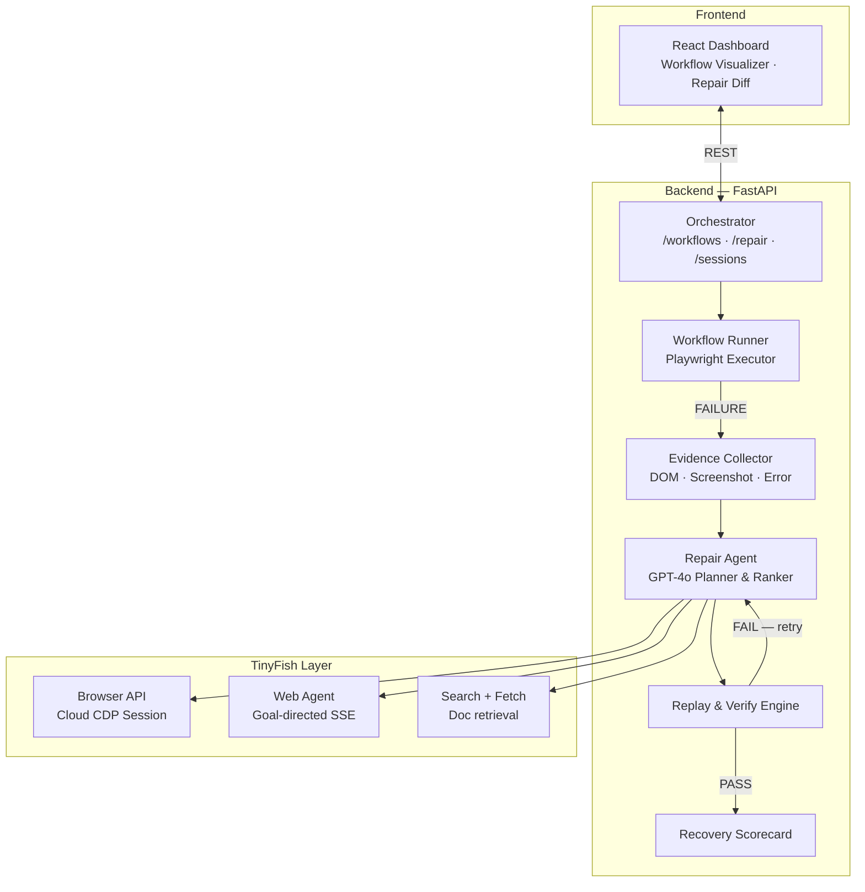
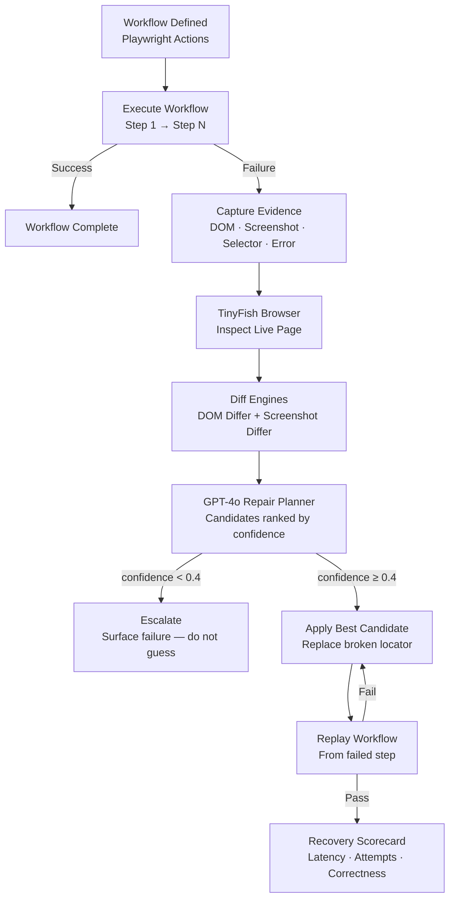
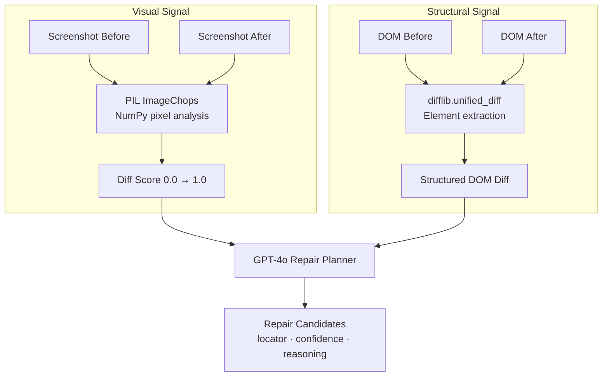
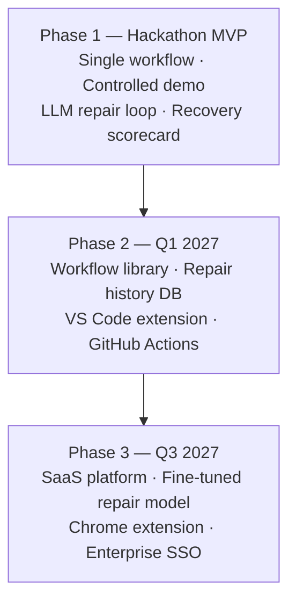

<div align="center">

# WebMender AI — The Self-Healing Browser Agent


<br /><br />

> ### *"Websites change. Your AI agent shouldn't break."*

<br />

**WebMender AI** is a reliability layer for browser automation agents.
It detects when a workflow breaks, investigates the live page using TinyFish's cloud browser,
diffs the DOM and screenshots with AI, repairs the broken locator, and verifies the fix —
**all without human intervention.**

</div>

---

## ⚡ The Problem We're Solving

AI agents are increasingly expected to complete real-world tasks on the web: filling forms, collecting data, navigating portals. But the web is a moving target.

```
Day 1:  workflow clicks  →  button[id="btn-specifications"]   WORKS
Day 7:  Same workflow    →  button[id="tech-details-btn"]     FAILS
```

| Traditional Automation | WebMender AI |
|---|---|
| Breaks silently on selector changes | Detects failure instantly |
| Requires manual inspection | Inspects the live page autonomously |
| Engineer must rewrite the selector | LLM proposes and ranks repair candidates |
| No evidence trail | Full DOM diff + screenshot diff + audit log |
| Re-run fails again | Replays and validates the repaired workflow |

---

## 🏗️ System Architecture



---

## 🔄 The Self-Healing Pipeline



---

## 🐟 TinyFish Integration — The Core Enabler

WebMender AI integrates **all four TinyFish capabilities** as first-class infrastructure:

| Capability | How WebMender Uses It | Why It's Indispensable |
|---|---|---|
| **Browser API** | Spins up a cloud-browser session to execute workflows in a real environment and captures live DOM snapshots and screenshots after failure. | Without real browser execution, actual failures cannot be observed and live evidence cannot be gathered. |
| **Web Agent** | `POST /v1/automation/run-sse` — explores the broken page with a natural-language goal to discover the alternative interaction path. | The agent finds elements that CSS selectors cannot predict — aria labels, text content, contextual layout. |
| **Search API** | Retrieves public documentation or changelogs when a site's update notes are publicly available, enriching the LLM's repair context. | Gives the LLM external signal beyond the DOM — optional but powerful. |
| **Fetch API** | Extracts clean, AI-ready page content in markdown format to supplement the DOM diff with readable text context. | Gives the LLM a human-readable view of the page alongside raw HTML. |

```python
# TinyFish Web Agent exploration — called during repair
async for event in tinyfish.run_web_agent(
    goal="Find the button or link that reveals the product technical specifications",
    url="https://target-website.com/product/xyz",
    session_id=active_browser_session,
):
    print(event)   # SSE events: thought, action, observation, result
```

> **Integration is functional, not cosmetic.** Every repair loop calls the TinyFish Browser API to capture live evidence. For sites with unknown change patterns, the Web Agent is invoked to explore and discover paths autonomously.

---

## 📁 Project Structure

```
webmender-ai/
│
├── backend/                        # FastAPI Orchestration Server
│   ├── app/
│   │   ├── main.py                 # App entrypoint, CORS, router registration
│   │   ├── core/config.py          # Pydantic settings (TinyFish keys, LLM config)
│   │   ├── models/schemas.py       # Workflow, Failure, Repair, Scorecard schemas
│   │   ├── agents/
│   │   │   └── repair_agent.py     # AI repair planner (LLM + evidence → candidates)
│   │   ├── services/
│   │   │   ├── tinyfish_service.py # TinyFish Browser / Agent / Search / Fetch wrapper
│   │   │   ├── workflow_runner.py  # Playwright executor + failure capture + repair loop
│   │   │   ├── dom_differ.py       # DOM snapshot diff engine
│   │   │   └── screenshot_differ.py# Pixel-level screenshot comparison (PIL + NumPy)
│   │   └── api/routes/
│   │       ├── workflows.py        # POST /workflows/run
│   │       ├── repair.py           # GET|POST /repair/{session_id}
│   │       ├── sessions.py         # GET /sessions/{session_id}
│   │       └── health.py           # GET /health
│   ├── requirements.txt
│   └── .env.example
│
├── frontend/                       # React Dashboard (React Flow + Tailwind)
│   └── src/
│       ├── components/dashboard/   # KPI cards, timeline, status indicators
│       ├── components/workflow/    # React Flow workflow visualizer
│       ├── pages/                  # Dashboard, Sessions, Repair View
│       └── hooks/                  # useWorkflow, useRepair, useScorecard
│
├── demo/
│   ├── pages/version_a/index.html  # Original page — workflow succeeds
│   ├── pages/version_b/index.html  # Modified page — triggers self-healing
│   └── workflows/demo_spec_scraper.py
│
└── README.md
```

---

## 🧠 AI/ML Architecture Deep Dive

### Repair Agent Intelligence

The repair agent is not a brute-force retry machine. It reasons from structured evidence:

```
EVIDENCE IN:
  ├─ Original failed selector: #btn-specifications
  ├─ Error: TimeoutError — element not found after 5000ms
  ├─ DOM Diff: 47 changed lines
  │    - <button id="btn-specifications">Specifications</button>  (REMOVED)
  │    + <button id="tech-details-btn">Technical Details</button> (ADDED)
  └─ Screenshot diff score: 0.312 (31.2% visual change)

LLM REASONING:
  "The button 'Specifications' (id=btn-specifications) has been renamed to
   'Technical Details' (id=tech-details-btn). High semantic equivalence.
   CSS selector #tech-details-btn is the most reliable repair."

CANDIDATES OUT (ranked by confidence):
  1. CSS:   #tech-details-btn                        — confidence: 0.95
  2. Text:  button:has-text("Technical Details")     — confidence: 0.88
  3. XPath: //button[contains(text(),'Technical')]   — confidence: 0.71
```

### Multimodal Evidence Pipeline



---

## 🛠️ Tech Stack

| Layer | Technology | Purpose |
|---|---|---|
| **Orchestration** | Python 3.12 + FastAPI | Async API server, workflow management |
| **Browser Automation** | Playwright (async) | Execute and replay browser workflows |
| **Cloud Browser** | TinyFish Browser API | Real browser execution in the cloud |
| **Web Exploration** | TinyFish Web Agent | Goal-directed page exploration via SSE |
| **Web Intelligence** | TinyFish Search + Fetch | Documentation retrieval and page parsing |
| **AI Repair Planner** | OpenAI GPT-4o | Multimodal reasoning for locator repair |
| **DOM Diffing** | Python `difflib` | Structural DOM change detection |
| **Visual Diffing** | Pillow + NumPy | Pixel-level screenshot comparison |
| **Schema Validation** | Pydantic v2 | Type-safe data models throughout |
| **Frontend Dashboard** | React 18 + React Flow | Workflow visualizer, repair diff viewer |
| **Styling** | Tailwind CSS | Responsive, professional UI |

---

## 🚀 Quick Start

### Prerequisites

- Python 3.12+
- Node.js 20+
- TinyFish API key — [tinyfish.ai](https://tinyfish.ai)
- OpenAI API key

### 1. Backend

```bash
cd backend
pip install -r requirements.txt
playwright install chromium

cp .env.example .env
# Add your TINYFISH_API_KEY and OPENAI_API_KEY

uvicorn app.main:app --reload --port 8000
```

### 2. Demo Pages Server

```bash
cd demo/pages
python -m http.server 8080
```

### 3. Run the Demo

```bash
python demo/workflows/demo_spec_scraper.py
```

### 4. Frontend Dashboard

```bash
cd frontend
npm install
npm run dev
# Open http://localhost:5173
```

### 5. API Explorer

Visit `http://localhost:8000/api/docs` for the interactive Swagger UI.

---

## 🔌 API Reference

| Method | Endpoint | Description |
|---|---|---|
| `GET` | `/api/v1/health` | Service health check |
| `POST` | `/api/v1/workflows/run` | Start a workflow run |
| `GET` | `/api/v1/workflows/definitions` | List example workflow definitions |
| `GET` | `/api/v1/sessions/{id}` | Poll for recovery scorecard |
| `GET` | `/api/v1/repair/{id}` | Get repair plan details |
| `POST` | `/api/v1/repair/{id}/accept` | Accept repair and trigger replay |
| `POST` | `/api/v1/repair/{id}/reject` | Reject repair — escalate as unrecoverable |

---

## 🌐 Real-World Use Cases

**Enterprise QA Automation** — Stop paying engineers to update selectors after every UI redesign. WebMender repairs them automatically and logs every change with a full audit trail.

**Production AI Agents** — Your GPT-powered web agent breaks every time a target website updates. WebMender wraps it with a reliability layer that self-heals in real time.

**Web Scraping Pipelines** — Data pipelines that break on layout changes get expensive fast. WebMender recovers them and emits structured change audit trails.

**Regression Testing** — Catch unintended UI changes before your QA team does by running WebMender as part of your CI/CD pipeline.

---

## 📈 Roadmap



---

## 🏆 Built For

<div align="center">

**Kritical Hacks 2026**
Indira Gandhi Delhi Technical University for Women (IGDTUW)
AI/ML Track — Open Innovation

*Mandatory TinyFish Integration: Browser · Web Agent · Search · Fetch*

</div>
